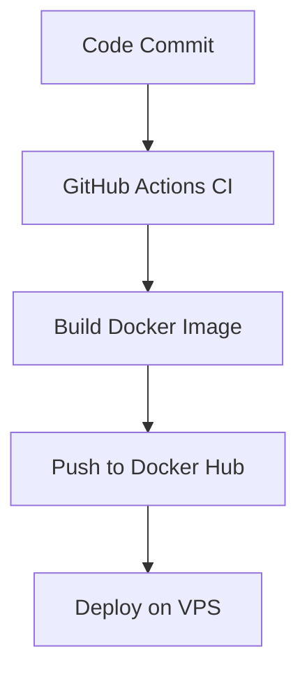

# DevOps Intern Screening Task

This repository contains a minimal Node.js web application, Docker configuration, GitHub Actions CI workflow, and a Linux health-check automation script.

## Application Endpoint

The app exposes one endpoint:

```http
GET /
```

Expected response:

```json
{
  "message": "Hello from DevOps Intern Task!",
  "status": "running"
}
```

## Project Structure

```text
.
├── .github/workflows/ci.yml
├── src/server.js
├── Dockerfile
├── docker-compose.yml
├── package.json
├── system_health.sh
└── README.md
```

## Run Locally with Docker Compose

Build and start the application:

```bash
docker-compose up --build
```

Open the app in your browser:

```text
http://localhost:8080
```

Stop the container:

```bash
docker-compose down
```

## Run the Bash Script

Give execute permission:

```bash
chmod +x system_health.sh
```

Run the script:

```bash
./system_health.sh
```

The script appends CPU, memory, and disk usage information to:

```text
health_log.txt
```

If disk usage is greater than 80%, it prints:

```text
[WARNING] Disk space high!
```

## CI Pipeline

The GitHub Actions workflow runs automatically on every push to the `main` branch.

It performs:

- Code checkout
- Node.js dependency installation
- Basic lint/syntax check
- Docker image build
- Docker image push to Docker Hub

To push the image to Docker Hub, add these GitHub repository secrets:

| Secret Name | Purpose |
| --- | --- |
| `DOCKERHUB_USERNAME` | Your Docker Hub username |
| `DOCKERHUB_TOKEN` | Docker Hub access token |

## End-to-End Workflow Diagram



## AWS or VPS Deployment Thought Process

- Launch an AWS EC2 instance or any VPS, then install Docker and Docker Compose on the server.
- Pull the Docker image from Docker Hub and run it with port `8080` exposed.
- Use a reverse proxy such as Nginx and configure security groups/firewall rules to allow HTTP or HTTPS traffic.

## Docker Best Practices Used

- Lightweight `node:20-alpine` base image.
- Multi-stage Dockerfile.
- Production dependencies only.
- Non-root user inside the container.
- `.dockerignore` file to avoid copying unnecessary files.
